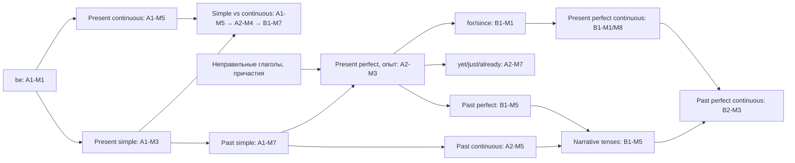
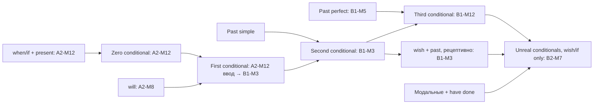

# 06 — Зависимости между темами

> Что ученик должен знать до перехода к следующей теме. Коды модулей: A1-M3 = уровень A1, модуль 3. Обозначения — как в 00.
>
> **Как построены зависимости:**
> - перекрёстные ссылки «→ Unit…» в EGU и EGIU (knowledge-analysis/01 §4.1) [ИСТ];
> - Grammar reminder в AGIU (там же, §4.2) [ИСТ];
> - порядок тем внутри EF [ИСТ];
> - распределение уровней по EGP как описательный ориентир, а не последовательность (00 §3) [ИСТ];
> - логическая зависимость формы, например: нужен past participle → нужен present perfect [РЕШ].

## 1. Правило допуска
Тема *Y* открывается, если все её обязательные предпосылки *X* достигнуты **по их типу цели** (00 §3.1; 07 §2):
- для **активного употребления** — статус «освоено» (не меньше 80% верных в отсроченной проверке через 3 и более дня **и** правильное употребление в задании на применение) [ГИПОТЕЗА по порогам];
- для **понимания** — понимание в 2 разных контекстах;
- для **готовой конструкции** — уместное употребление фразы.

Если предпосылка в статусе «изучено, не закреплено», тему *Y* можно открыть, но предпосылка встаёт в начало очереди повторения. [РЕШ]

Модуль **не открывается по календарю**: при темпе 4–6 занятий в неделю (решение №8) правило допуска проверяется по данным, а не по дате.

## 2. Глагольная система — основная цепочка

| ID | Тема | Где | Требует | Открывает | EGP |
|---|---|---|---|---|---|
| V1 | be (+/–/?) | A1-M1 | — | V2, V3, there is | A1 |
| V2 | Present simple | A1-M3 | V1, личные местоимения | V4, V5, вопросы с do | A1 |
| V3 | Present continuous | A1-M5 | V1 | V4, будущее (договорённости) | A1 |
| V4 | Simple vs continuous; action / non-action verbs | A1-M5 → A2-M4 → B1-M7 | V2, V3 | — | A1–B1 |
| V5 | Past simple | A1-M7 | V2 (вспомогательный do), неправильные глаголы | V6, V7 | A1–A2 |
| V6 | Past continuous | A2-M5 | V3, V5 | V10 | A2 |
| V7 | Present perfect (опыт); superlative + ever (A2-M3, после V7 и D3) | A2-M3 | V5, past participles | V8, V9, V11 | A2 |
| V8 | yet / just / already | A2-M7 | V7 | — | A2 |
| V9 | for / since; PP vs past (2) | B1-M1 | V7 | V12 | A2–B1 |
| V10 | Past perfect; narrative tenses | B1-M5 | V5, V6, V7 (have + participle) | V13, третий тип условия, косвенная речь | B1 |
| V11 | used to | B1-M2 | V5 | V14 | B1 |
| V12 | Present perfect continuous | B1-M1 → B1-M8 → B2-M2 | V3, V9 | V13 | B1 |
| V13 | Past perfect continuous | B2-M3 | V10, V12 | — | B1–B2 |
| V14 | would для привычек; be / get used to | B1-M11 (рецептивно) → B2-M8 | V11, -ing после предлога | — | B2 / нет данных |

## 3. Будущее

| ID | Тема | Где | Требует | EGP |
|---|---|---|---|---|
| F1 | would like; will (формульно) | A1-M10 | V1 | A1 |
| F2 | going to (планы, прогнозы) | A2-M2 | V1, инфинитив | A2 |
| F3 | Present continuous для договорённостей | A2-M2 | V3 | A2 |
| F4 | will / won't / shall (прогнозы, обещания, предложения) | A2-M8 | F1 | A1–A2 |
| F5 | Выбор формы будущего | B1-M7 | F2, F3, F4 | A2–B1 |
| F6 | Придаточные времени о будущем (when, until, as soon as) | A2-M12 → B1-M12 → B2-M6 | F4, V2 | A2–B1 |
| F7 | Future continuous / future perfect | B2-M5 | F4, V3, V7 | A2–B2 / B2 |

## 4. Модальность

| ID | Тема | Где | Требует | EGP |
|---|---|---|---|---|
| M1 | can / can't | A1-M5 | V2 (инфинитив без to) | A1 |
| M2 | have to / must / mustn't / don't have to | A2-M7 | M1, V2 | A2 |
| M3 | should | A2-M10 | M1 | A2 |
| M4 | might (возможность) | **A2-M8** → B1-M2 (повторение) | M1, F4 | A2 (possibility) – B1 |
| M5 | Обязанность и умение: системно (could, be able to) | B1-M10 | M1–M3, V5 | A2–B1 |
| M6 | Предположения о настоящем (must / might / can't) | B1-M11 | M2, M4 | B1 (can't — B2) |
| M7 | Модальные + have done (must / might / can't / should / could have) | B2-M9 | M6, V7 | B1–B2 |

## 5. Условные предложения и нереальность

| ID | Тема | Где | Требует | EGP |
|---|---|---|---|---|
| C0 | Zero conditional | A2-M12 | V2, imperative | A2 |
| C1 | First conditional | A2-M12 (понимание, готовые конструкции) → B1-M3 (активно), M12 | C0, F4 | B1 |
| C2 | Second conditional | B1-M3 | C1, V5 (past как нереальность), would | B1 |
| C3 | Third conditional | B1-M12 | C2, V10 | B1 |
| C4 | Unreal conditionals (смешанные), wish / if only | B2-M7 | C3, M7 | B1–B2 (смешанные — C1) |
| C5 | Союзы условия: unless, as long as, provided | B2-M6 | C1 | B1–B2 |

## 6. Пассив и передача речи

| ID | Тема | Где | Требует | EGP |
|---|---|---|---|---|
| P1 | Passive: present / past simple | B1-M4 | V2, V5, past participles | A2–B1 |
| P2 | Passive: другие времена (рецептивно) | B1-M11 | P1, V3, V7 | B1–B2 |
| P3 | Passive: все формы; have sth done; it is said that | B2-M10 | P2, модальные | B2 |
| R1 | Reported speech: утверждения; say / tell | B1-M6 | V5, V10 (сдвиг времён), местоимения | A2–B1 |
| R2 | Reported questions; косвенные вопросы | B1-M6 | R1, порядок слов в вопросах | A2–B1 |
| R3 | Reporting verbs | B2-M10 | R1, R2, глагольные модели G2 | B1–B2 |

## 7. Вопросы

| ID | Тема | Где | Требует | EGP |
|---|---|---|---|---|
| Q1 | Вопросы с be | A1-M1 | V1 | A1 |
| Q2 | Вопросы с do / does / did; порядок слов | A1-M3, M10 | V2, V5 | A1–A2 |
| Q3 | Вопросы к подлежащему; косвенные вопросы | B1-M6 | Q2 | A2 |
| Q4 | Question tags | B1-M6 (далее — повторение) | Q2, вспомогательные во всех временах | A2–C1, основная масса B1 |
| Q5 | Отрицательные и эхо-вопросы; вопросы с предлогом в конце | B2-M1 | Q3, Q4 | B1–B2 |

## 8. Именная группа

| ID | Тема | Где | Требует | EGP |
|---|---|---|---|---|
| N1 | a/an, множественное число, this/that | A1-M2 | — | A1 |
| N2 | Притяжательный падеж 's | A1-M4 (ввод) | N1 | A2 |
| N3 | some / any; there is/are | A1-M8 | N1, V1 | A1 |
| N4 | Countable / uncountable; how much / many | A1-M9 → A2-M6 | N3 | A2 |
| N5 | Артикли (the / нулевой) | A2-M11 → B1-M9 → B2-M12 | N1, N4 | A1–B2 |
| N6 | Quantifiers (too, enough, a lot of, all, every, both…) | A2-M6 → B1-M9 → B2-M12 | N4 | A2–B2 |
| N7 | Местоимения: объектные, притяжательные, неопределённые, возвратные | A1-M6 → A2-M6, M10 | местоимения A1-M1 | A1–A2 |
| N8 | Неисчисляемые и множественные существительные (особые случаи) | B2-M11 | N4, N5 | B2 |

## 9. Прилагательные, наречия, сравнение

| ID | Тема | Где | Требует | EGP |
|---|---|---|---|---|
| D1 | Прилагательные (позиция), very / really / quite | A1-M2 | V1 | A1 |
| D2 | Наречия частотности (позиция) | A1-M4 | V2 | A1 |
| D3 | Comparatives / superlatives; as…as | A2-M1 | D1 | A2 |
| D4 | Наречия образа действия | A2-M4 | D1, V2 | A1–A2 |
| D5 | -ed / -ing прилагательные | A2-M6 → B1-M10 | D1 | — |
| D6 | Выбор сравнительной или превосходной степени | B1-M9 | D3 | A2–B2 |
| D7 | the… the… + comparative | B2-M1 | D3 | B2 |
| D8 | Позиция наречий и наречных оборотов; порядок прилагательных | B2-M2, M4 | D1, D2, D4 | A1–B2 / нет данных |

## 10. Глагольные модели и придаточные

| ID | Тема | Где | Требует | EGP |
|---|---|---|---|---|
| G1 | like / love / hate + -ing; would like + to | A1-M6, M10 | V2 | A1 |
| G2 | verb + to / verb + -ing (частотные глаголы); инфинитив цели | A2-M9 | G1 | A1–A2 (verb + to, enjoy + -ing, цель) |
| G3 | Широкий круг глаголов + -ing; выбор gerund / infinitive; смена смысла | B1-M7 → B2-M8 | G2 | B1 (широкий круг); B2 (смена смысла) |
| S1 | and / but / because / so | A1 | — | A1 |
| S2 | Связки последовательности (then, when, while) | A2-M5 | S1, V6 | A2 |
| S3 | Определительные придаточные (who / which / that / where) | A2-M11 | S1, Q (wh-слова) | A2 |
| S4 | Описательные придаточные (non-defining) | B1-M5 | S3 | A2–B2 |
| S5 | Уступка и цель (although, despite, in order to, so that) | B2-M11 | S1, G2 | B1–B2 |
| S6 | so / such… that | B2-M3 | D1 | B1 |

## 11. Межуровневые «ворота»

| Переход | Обязательные темы (ворота) | Основание |
|---|---|---|
| A1 → A2 | Активно: be, present simple / continuous, past simple (базовые утверждения), there is/are, can. Как готовые конструкции: вопросы с do и wh-вопросы, 's | Основа всех тем A2 (§2–§7). Вопросы с do на A1 — готовые конструкции (ориентир EGP: A2) |
| A2 → B1 | present perfect (опыт), past continuous, going to / will, might, comparatives, have to / should, defining relative clauses | Предпосылки для B1-M1, M2, M3, M5, M9 |
| B1 → B2 | все perfect-формы, past perfect, условные 1–3, passive (present / past), reported speech, gerund / infinitive | EF-UI исходит из этих тем как из повторения (например, UI 5A «unreal conditionals», UI 8A «passive (all forms)») |
| B2 → C1 | блоки Grammar reminder AGIU (стр. 222–239) | AGIU сам называет их предварительно известными |

## 12. Зависимости для навыков (не только грамматика)
| Навык или задача | Требует |
|---|---|
| Рассказ (A2-M5, B1-M5, B2-M3) | прошедшие времена + связки (S2) + лексика последовательности |
| Эссе «за и против» (B1-M8 → B2-M5, M11) | связки контраста и добавления (S5), выражения мнения (функции B1-M9) |
| Отчёт (B2-M10) | пассив (P3), безличные конструкции, связность |
| Формальное письмо (A1-M9 → A2-M6 → B1-M10 → B2-M6) | вежливые формулы, would like / could you, косвенные вопросы (Q3) — с B1 |
| Медиация: пересказ (B1-M6) | reported speech (R1, R2) |
| Согласование условий (B2-M6); переговоры с пределами уступок (B2-M11, B2+) | условные с союзами (C5), модальные смягчения; для B2+ — S5 (уступка и цель) |
