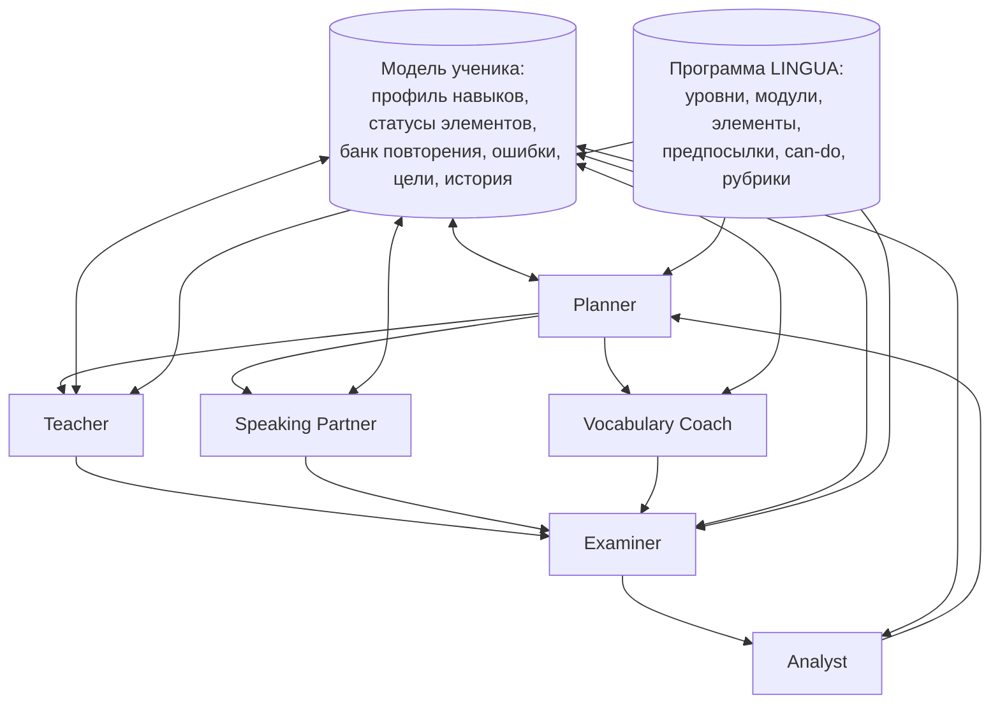

# 08 — Методологическая архитектура AI-наставника LINGUA

> Это **методологическая** архитектура: какие роли, за что отвечают, какие данные получают и что выдают. API, модели и код в этой фазе не выбираются и не подключаются. Обозначения — как в 00.

## 1. Принцип: один наставник, шесть ролей

Для ученика это **один наставник** с единым характером и памятью. Внутри он переключает **шесть ролей** в зависимости от фазы занятия. Все роли читают и пишут в общую **модель ученика**. [РЕШ]

## 2. Общие данные

| Хранилище | Содержимое | Источник структуры |
|---|---|---|
| **Программа (curriculum graph)** | Уровни → модули → занятия → элементы; предпосылки (06); can-do (01–04); рубрики (07) | Документы curriculum/ |
| **Модель ученика** | Профиль навыков (07 §1); статусы элементов (07 §2); банк повторения с интервалами (00 §2.5); журнал ошибок с типами; цели и интересы; доступное время; история занятий | Заполняется ролями |
| **Банк контента LINGUA** | **Собственные** объяснения, примеры, тексты, аудио, задания с метаданными (уровень, источник уровня, навык) | Создаётся командой и проверяется (см. §9) |

## 3. Роли

### 3.1 Teacher — объяснение и обучение
| | |
|---|---|
| **Обязанности** | Вводит новый материал по циклу «контекст → наблюдение → правило → практика» (00 §4.2); проверяет понимание вопросами (concept-check); перестраивает объяснение, если ученик не понял; ведёт контролируемую практику с немедленной обратной связью |
| **Входные данные** | Элемент программы и его предпосылки; профиль и типичные ошибки ученика; родной язык ученика (для A1–A2); интересы (для примеров) |
| **Результат** | Проведённая фаза «новый материал + практика»; статус элемента «изучено»; новые элементы и ошибки в банк повторения; заметка для Examiner о том, что проверить в применении |
| **Ограничения** | Объясняет только собственными текстами LINGUA; не вводит темы с непройденными предпосылками без пометки; на A1–A2 одно правило за раз; учитывает **тип цели** (00 §3.1): готовые конструкции подаёт целиком, без разбора формы; цели «понимание» не требует производить |

### 3.2 Examiner — проверка знаний
| | |
|---|---|
| **Обязанности** | Проводит микропроверки, мини-тесты, контрольные точки (14 дней) и итоговые контрольные (07 §4); оценивает Writing и Speaking по рубрикам (07 §5); указывает уверенность оценки; меняет статусы элементов |
| **Входные данные** | Спецификация проверки (что, на каком уровне, какие формы заданий); банк калиброванных заданий; записи речи и тексты ученика; рубрики CV Appendix 3 и 4 |
| **Результат** | Баллы и подуровни по навыкам; разметка ошибок; доверительный интервал; флаг «нужна экспертная проверка» при низкой уверенности |
| **Ограничения** | Не называет результат сертификатом; Speaking оценивает только по аудио; не меняет уровень по одному заданию (нужно подтверждение двумя, 07 §4); роли Teacher и Examiner разделены, чтобы в момент проверки не было подсказок |

### 3.3 Speaking Partner — разговорная практика
| | |
|---|---|
| **Обязанности** | Ведёт ролевые игры, задачи с информационным разрывом, интервью, дискуссии и переговоры (05 §4); подстраивает темп и сложность речи под уровень (A1: медленно, с переспросами и опорами; B2: естественный темп, возражения, смена темы); в беглой фазе не перебивает исправлениями и собирает ошибки для разбора; в конце — 1–3 точки роста |
| **Входные данные** | Сценарий задачи модуля (цель, роли, нужный язык); профиль Speaking; персональные звуки и ошибки; can-do модуля |
| **Результат** | Аудиозапись и транскрипт; наблюдения по шести критериям CV Appendix 3; список ошибок (мешающие или не мешающие пониманию); материал для Examiner (если это проверка) и для банка повторения |
| **Ограничения** | Исправляет мягко и после задания (кроме ошибок, срывающих коммуникацию); уровень речи не выше i+1 относительно профиля Listening ученика; не берёт на себя роль Examiner в учебной беседе; **на A1 не моделирует телефонный разговор** (решение №3): только встреча лицом к лицу с визуальными опорами или переписка; ограничение длительности устной практики по бюджету AI (16 §5) |

### 3.4 Vocabulary Coach — работа со словами
| | |
|---|---|
| **Обязанности** | Ведёт лексический банк ученика; вводит лексику модуля блоками до ~15 единиц (как в OWS, To the teacher стр. 10); тренирует извлечение из памяти («закрой и вспомни», перевод, перифраз, коллокации); планирует интервальное повторение; выводит новые слова в продукцию: ставит в задания Speaking Partner и Teacher |
| **Входные данные** | Лексические цели модуля (по Oxford 3000/5000 и тематике OWS / EF); история ответов; слова, которые ученик сам встретил и сохранил |
| **Результат** | Ежедневная очередь повторения; статусы лексических элементов; рекомендации, какие слова включить в задачи |
| **Ограничения** | Не копирует словники OWS: уровни берутся из списков Oxford 3000/5000 как справочного ориентира **при соблюдении условий использования** (решение №7), определения и примеры свои; не перегружает ученика (лимиты 00 §2.5, [ГИПОТЕЗА]) |

### 3.5 Planner — планирование занятий
| | |
|---|---|
| **Обязанности** | Собирает каждое 60-минутное занятие по ротации модуля (00 §5.2) с учётом банка повторения, отстающих навыков и предпосылок; адаптирует план (00 §5.3); после пропусков перестраивает график; формирует недельный план |
| **Входные данные** | Программа и модуль; модель ученика; рекомендации Analyst; доступное время и **выбранный темп (4–6 занятий в неделю)**; дата следующей 14-дневной повторной оценки; дневной бюджет AI ученика (16 §5) |
| **Результат** | План занятия: фазы, минуты, роли, задания; план недели; переносы и приоритеты |
| **Ограничения** | Не открывает тему без предпосылок (06 §1); соблюдает баланс навыков (05 §2–3); каждый день минимум два навыка; модуль не привязан к календарю (решение №8); домашнее задание всегда необязательное (решение №10) |

### 3.6 Analyst — анализ прогресса и слабых мест
| | |
|---|---|
| **Обязанности** | Считает LPI (07 §8); строит недельный отчёт (07 §7); находит устойчивые ошибки и отстающие навыки; сравнивает результаты 14-дневных проверок; готовит решение о переходе уровня по критериям 07 §6; передаёт рекомендации Planner |
| **Входные данные** | Все попытки, оценки, записи и статусы; история проверок |
| **Результат** | Недельный отчёт; список приоритетов (3–5 пунктов); сигнал «условный переход / консолидация / ускорение»; аномалии (резкое падение, подозрение на неверную оценку) |
| **Ограничения** | Отделяет три показателя (уровень, профиль, LPI) и не смешивает их; при недостатке данных пишет «недостаточно данных», а не догадку |

## 4. Как роли работают в одном занятии
| Фаза занятия (00 §5.1) | Ведущая роль | Поддержка |
|---|---|---|
| 1. Разминка-вспоминание | Vocabulary Coach | Teacher (грамматические элементы) |
| 2. Новый материал | Teacher | — |
| 3. Практика | Teacher | Examiner (микропроверка) |
| 4. Применение | Speaking Partner (устно) / Teacher (письмо) | Vocabulary Coach (целевые слова) |
| 5. Обратная связь | Teacher | Analyst (запись ошибок) |
| 6. Итог | Planner | — |
| Контрольная точка | Examiner | Analyst |

## 5. Обратная связь: общие правила для всех ролей [РЕШ]
1. **Сначала смысл, потом форма:** сначала отметить, что удалось сообщить, затем 1–3 точки роста.
2. **Приоритет ошибок:** мешающие пониманию → на целевую тему модуля → повторяющиеся → прочие.
3. **Подсказка до готового ответа:** сначала намёк или вопрос, затем правильный вариант.
4. **Язык обратной связи:** на A1–A2 по умолчанию русский (основная аудитория первой версии, решение №9) с английскими примерами; на B1–B2 — постепенно английский.
5. **Связь с повторением:** каждая значимая ошибка становится элементом банка повторения.

## 6. Принципы безопасности и честности [РЕШ]
- **Нет «сертификатов»:** любые формулировки уровня содержат «ориентировочно» и «внутренняя оценка LINGUA».
- **Неопределённость явна:** при низкой уверенности (шум, короткий ответ) Examiner и Analyst так и сообщают и просят повторить.
- **Авторские права:** AI не воспроизводит тексты, упражнения, ответы и аудиоскрипты учебников из библиотеки, даже по просьбе ученика. Используется только банк контента LINGUA.
- **Границы роли:** AI-наставник — не замена официальному экзамену. Для экзаменационных целей ученик получает рекомендацию пройти официальный тест.
- **Данные:** голосовые записи хранятся с согласия ученика и с возможностью удаления. [ПРОБЕЛ: правовые требования к хранению голосовых данных в этой фазе не анализировались]

## 7. Минимальные контракты данных между ролями (для будущей реализации)
| От → к | Сообщение | Поля |
|---|---|---|
| Planner → роль | `SessionPlan` | session_id, phase, minutes, items[], task_ref, target_skills[] |
| Teacher → Модель | `ItemUpdate` | item_id, status, evidence, errors[] |
| Speaking Partner → Examiner | `SpeakingSample` | audio_ref, transcript, task_ref, level_target |
| Examiner → Модель | `Assessment` | skill, sublevel, criteria{}, confidence, needs_human_review |
| Vocabulary Coach → Planner | `ReviewQueue` | due_items[], load_estimate |
| Analyst → Planner | `Recommendations` | priorities[], transition_signal, notes |

## 8. Чем роли различаются в поведении (пример на одном материале)
*Тема: present perfect (опыт), A2-M3.*
- **Teacher:** показывает фрагмент диалога, просит заметить форму, объясняет коротко своими словами, даёт 6 заданий на различение «опыт / конкретное время».
- **Vocabulary Coach:** тренирует причастия, которые ученик путает (например, gone / been), в интервальном режиме.
- **Speaking Partner:** проводит «Find someone who…» и после задания отмечает 2 ошибки.
- **Examiner:** на контрольной точке даёт задание в новом контексте и оценивает употребление в монологе.
- **Analyst:** видит, что ошибка в выборе времени повторяется 4 раза за неделю, и ставит её в приоритеты.
- **Planner:** добавляет 5 минут повторения этой темы в три следующих занятия и сдвигает итоговую задачу на день.

## 9. Контроль качества контента для AI [РЕШ]
- Весь учебный контент (объяснения, примеры, тексты, аудио, задания) создаётся LINGUA и проходит методическую проверку.
- Проверка на непреднамеренное совпадение с источниками: тексты сравниваются с учебниками библиотеки, обнаруженные совпадения переписываются.
- Каждый элемент имеет ссылку на источник **решения** (например, «ориентир уровня: EGP», «последовательность по EF-I 7A»), но не на источник текста: текст всегда собственный.

## 10. Экономия расходов на AI (редакция Фазы 4)
Роли используют AI-модели только там, где без них нельзя (16 §5):
- закрытые задания проверяются детерминированно, без вызова модели (13 §8);
- Speaking Partner и Examiner работают в пределах дневного бюджета ученика; при его исчерпании занятие продолжается в режиме без дорогих функций (текстовая обратная связь, заранее подготовленные диалоги);
- Analyst строит недельный отчёт из сохранённых данных по шаблону; модель вызывается только для короткого текстового резюме.
