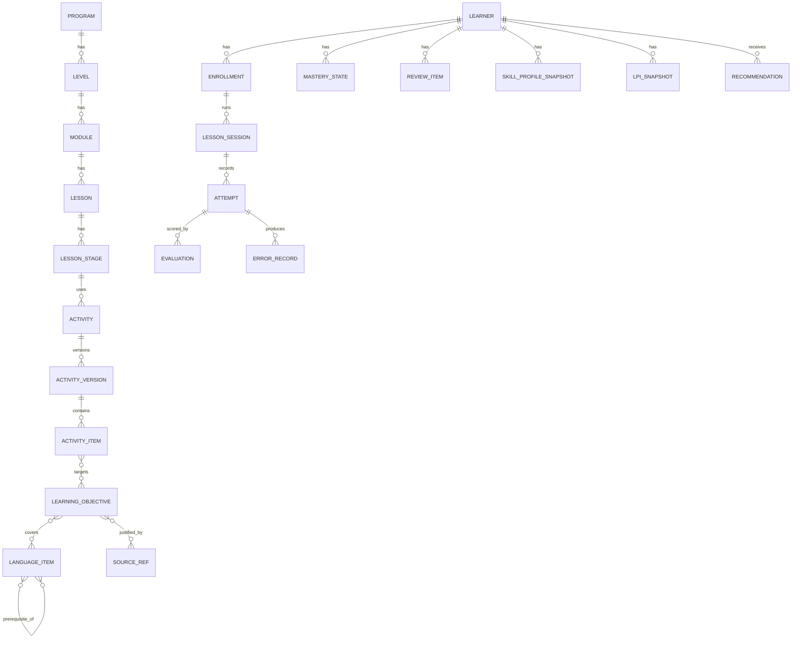

# 13 — Модель данных обучения (спецификация)

> Фаза 3, часть 4. Это **спецификация сущностей и правил**, без кода, схемы конкретной СУБД и подключения к базе. Типы полей логические: строка, число, дата-время, ссылка, список, перечисление, структура. Модель согласована с 00, 07, 08, 11, 12.

## 1. Принципы

1. **Контент и данные учеников хранятся раздельно.** Уроки и задания — общий каталог; попытки и результаты — у каждого ученика свои.
2. **Версионирование контента.** Любое изменение задания создаёт новую версию. Попытка всегда ссылается на ту версию, которую видел ученик. Так история не «ломается» при правке уроков.
3. **Прослеживаемость к источникам решений.** У элементов программы есть ссылка на основание: шкала CV, пункт EGP, урок EF, юнит Murphy, юнит OWS. Тексты учебников в модели **не хранятся**.
4. **Три показателя раздельно:** ориентировочный уровень, профиль навыков, LPI (07 §1).
5. **Всё, что влияет на решение системы, объяснимо:** у каждой рекомендации и смены статуса есть ссылка на доказательства (попытки, оценки).
6. **Многопользовательность:** все данные ученика привязаны к его идентификатору. Предусмотрено поле организации (школа, группа) для будущих B2B-сценариев.
7. **Приватность:** голос и тексты учеников — персональные данные, они хранятся с согласием и сроками хранения (§11).

## 2. Обзор сущностей

## 3. Каталог программы и контента

### 3.1 Program / Level / Module
| Сущность | Ключевые поля | Примечания |
|---|---|---|
| **Program** | id, название, версия программы, статус (черновик / активна / архив) | Позволяет вести несколько редакций программы |
| **Level** | id, program_id, код (Pre-A1, A1, A2, B1, B2), подуровни (A1.1, A1.2 / A2, A2+ …), выходные can-do (ссылки), критерии перехода (ссылка на правило 07 §6) | Plus-уровни по CV стр. 38 |
| **Module** | id, level_id, порядковый номер, название, подуровень, тема, can-do модуля, итоговая задача (ссылка на Activity), список целей (LearningObjective), число занятий (по умолчанию 12), версия | 00 §4.1; 01–04 |

### 3.2 Lesson / LessonStage
| Сущность | Ключевые поля | Примечания |
|---|---|---|
| **Lesson** (шаблон занятия) | id, module_id, номер в модуле, название, **тип** (A, B, C, D, E, F, G, H, K по 11 §4), главная can-do цель, языковые цели, плановая длительность (60), предпосылки (ссылки на LanguageItem), варианты по путям (0 / 1 / 2), домашнее задание (ссылка на Activity, необязательно), версия, статус | Типы и этапы — 11 |
| **LessonStage** | id, lesson_id, порядок, этап (warm-up, input, practice, use, feedback, wrap-up, test), цель этапа, плановая длительность, роль AI (Teacher, Examiner, Speaking Partner, Vocabulary Coach, Planner, Analyst), список Activity, **критерии успеха** (структура: метрика, порог, источник порога: ГИПОТЕЗА / решение), правила ветвления (§9) | 11 §2, §5 |

### 3.3 Activity / ActivityVersion / ActivityItem
| Сущность | Ключевые поля | Примечания |
|---|---|---|
| **Activity** | id, название, назначение (практика / применение / тест / домашнее), навыки (L, R, S, W, P, Med, Language), уровень, текущая версия | «Контейнер» задания |
| **ActivityVersion** | id, activity_id, номер версии, автор, дата, причина изменения, инструкция (на английском + перевод для A1–A2), медиа (ссылки на MediaAsset), формат взаимодействия (одиночный, диалог с AI, письмо, запись), **тип проверки** (§8), рубрика (ссылка на Rubric, если нужна), статус (черновик / проверено методистом / опубликовано / выведено) | Попытки ссылаются на версию |
| **ActivityItem** | id, version_id, порядок, тип элемента (выбор, пропуск, сопоставление, упорядочивание, короткий ответ, свободный ответ, устный ответ, задача-диалог), стимул (текст / медиа), допустимые ответы (§8), подсказки (упорядоченный список), объяснение ошибки, цели (LearningObjective), трудность (оценочная + калиброванная после пилота) | Один «вопрос» внутри задания |

### 3.4 Learning objectives и языковые элементы
| Сущность | Ключевые поля | Примечания |
|---|---|---|
| **LearningObjective** | id, формулировка can-do или языковой цели, **тип цели** (продуктивная / рецептивная / формульная), уровень, модуль(и), связанные LanguageItem, критерий освоения (ссылка на правило 07 §2 с поправкой на тип), источники (SourceRef) | Тип цели — предложение аудита №2 |
| **LanguageItem** | id, вид (грамматический паттерн, лексическая единица, коллокация, функциональная фраза, особенность произношения), значение или описание (собственное), уровень, **источник уровня** (EGP-ID, Oxford-уровень, CV-шкала, решение LINGUA), предпосылки (список LanguageItem), тематические теги | Узлы графа зависимостей (06) |
| **CanDo** | id, уровень, навык, формулировка LINGUA, шкала CV (название, страница), отметка «пересказ CV» или «дополнение LINGUA» | Предложение аудита G-6 |
| **SourceRef** | id, тип источника (CV, EGP, EF, EGU, EGIU, AGIU, OWS, решение), идентификатор (страница, ID пункта, урок, юнит), краткое описание основания | **Без текстов источника** |
| **Rubric** | id, назначение (Speaking, Writing, Mediation), критерии (Range, Accuracy, Fluency, Interaction, Coherence, Phonology / Overall, Range, Coherence, Accuracy, Description, Argument), уровни и наблюдаемые признаки, источник (CV Appendix 3 / 4) | 07 §5 |
| **MediaAsset** | id, вид (аудио, изображение, видео), длительность, голоса, темп, уровень, транскрипт (собственный), права (собственный / лицензия) | Аудио LINGUA создаёт сама |

## 4. Ученик и обучение

| Сущность | Ключевые поля | Примечания |
|---|---|---|
| **Learner** | id, организация (необязательно), дата регистрации, язык интерфейса (по умолчанию русский), **родной язык (языки)** (по умолчанию русский, решение №9), часовой пояс, статус | Родной язык нужен для обратной связи и профиля произношения (аудит P-2) |
| **LearnerGoals** | learner_id, цели (путешествия, работа, экзамен…), интересы (для тем), **желаемый темп: 4–6 занятий в неделю** (решение №8; допускается меньше с предупреждением о сроках), длительность занятия (60), согласие на необязательное домашнее задание | Ритм — предложение аудита №10 |
| **Consent** | learner_id, тип (запись голоса, хранение текстов, использование для улучшения моделей), статус, дата, срок | §11 |
| **Placement** | id, learner_id, дата, версия теста, результаты частей (Grammar, Vocabulary, R, L, W, S, Pronunciation), ориентировочный уровень + уверенность, флаг «выше диапазона диагностики (B2+)», профиль, пробелы, рекомендованная точка входа, путь (0 / 1 / 2), статус (полная / частичная, например без Speaking) | 14; 15 |
| **Enrollment** | id, learner_id, program_version, текущий уровень, модуль, занятие, путь, дата начала, статус (активно / пауза / завершено) | |
| **PathAssignment** | id, enrollment_id, модуль, путь, причина (диагностика / разминка / мини-тест / решение ученика), дата | История смен пути |

## 5. Проведённые занятия и попытки

| Сущность | Ключевые поля | Примечания |
|---|---|---|
| **LessonSession** | id, learner_id, lesson_id + версия, дата и время начала и конца, путь, статус (начато / завершено / прервано), фактическое время по этапам, самооценка по can-do, итог (LessonResult) | 11 §3 |
| **StageRun** | id, session_id, stage_id, начало, конец, применённые ветвления (§9), роль AI | Для анализа реалистичности 60 минут |
| **Attempt** | id, learner_id, session_id (или review_session_id), activity_version_id, item_id, контекст (разминка / практика / применение / тест / домашнее / повторение), номер попытки, ответ (Response), правильность (верно / частично / неверно / не оценено), время ответа, число подсказок, дата-время | **Неизменяемая запись** |
| **Response** | attempt_id, тип (выбор, текст, аудио), содержимое или ссылка на аудио, транскрипт (для аудио), метаданные записи (длительность, качество) | |
| **Evaluation** | id, attempt_id, источник оценки (автомат / AI-модель + версия / эксперт), оценки по критериям рубрики, итоговый подуровень (для S / W), **уверенность**, флаг «нужна экспертная проверка», комментарий | Несколько оценок одной попытки возможны (AI + эксперт) |
| **Feedback** | id, attempt_id или session_id, что получилось, точки роста (ссылки на ErrorRecord), язык обратной связи, реакция ученика (исправил сам / после подсказки / нет) | 08 §5; 11 §6 |
| **LessonResult** | session_id, цели занятия и статус по каждой, ключевые ошибки, новые элементы повторения, самооценка | Итог этапа 6 |

## 6. Ошибки

| Сущность | Ключевые поля | Примечания |
|---|---|---|
| **ErrorRecord** | id, learner_id, attempt_id, фрагмент ученика, исправленный вариант, **тип ошибки** (ErrorType), связанный LanguageItem, **влияние** (мешает пониманию / не мешает), контекст (устно / письменно; практика / свободная речь), исправлена ли самостоятельно, дата | |
| **ErrorType** (справочник) | код, категория (грамматика, лексика, произношение — звук или просодия, орфография, пунктуация, дискурс и связность, социолингвистика и регистр), подкатегория (например, грамматика → время → present perfect vs past simple), описание | Справочник расширяемый |
| **ErrorPattern** (агрегат) | learner_id, error_type, LanguageItem, частота за 7, 14, 28 дней, последний случай, статус (активная / ослабевает / устранена) | Основа для приоритетов Analyst |

**Правило:** ErrorRecord с влиянием «мешает пониманию» или повторившийся ≥ 2 раз за 7 дней [ГИПОТЕЗА] создаёт или обновляет ReviewItem типа «личная ошибка».

## 7. Освоение, повторение, профиль, прогресс

| Сущность | Ключевые поля | Примечания |
|---|---|---|
| **MasteryState** | learner_id, objective_id (или LanguageItem), тип цели, статус (не начато / введено / изучено / закреплено / освоено / требует возврата), доказательства (ссылки на Attempt), дата смены статуса | 07 §2 + типы целей |
| **ReviewItem** | id, learner_id, объект (LanguageItem / ErrorPattern / фраза), вид (лексика, паттерн, функция, звук, личная ошибка), дата создания, источник (занятие, ошибка, ученик сам добавил) | |
| **ReviewSchedule** | review_item_id, текущий интервал, следующая дата, лёгкость, серия верных ответов, история интервалов | Интервалы 1–3–7–14–30–60 [ГИПОТЕЗА] |
| **ReviewEvent** | review_item_id, attempt_id, результат, новый интервал | |
| **AssessmentEvent** | id, learner_id, тип (диагностика / мини-тест / контрольная модуля / 14-дневная повторная / контрольная подуровня / итоговая уровня), форма (вариант параллельной формы), дата, результаты по частям, ссылки на Attempt | 07 §4 |
| **SkillProfileSnapshot** | id, learner_id, дата, источник (AssessmentEvent), подуровень и уверенность по навыкам (L, R, S-продукция, S-взаимодействие, W, Med, Grammar, Vocabulary, Pronunciation) | |
| **LevelEstimate** | id, learner_id, дата, ориентировочный уровень, уверенность, обоснование (ссылки), **отметка «внутренняя оценка, не сертификат»** | |
| **LPISnapshot** | learner_id, дата, значение, компоненты (освоение, удержание, навыки, регулярность), версия формулы | 07 §8 |
| **WeeklyReport** | id, learner_id, неделя, разделы (07 §7), ссылки на данные, версия шаблона | |
| **TransitionDecision** | id, learner_id, с уровня, на уровень, решение (переход / условный / консолидация / ускорение), проверенные критерии и их значения, версия правила, кто подтвердил (система / эксперт) | 07 §6 |

## 8. Проверка ответов: типы проверки

| Тип проверки | Применение | Что хранится в ActivityItem | Результат |
|---|---|---|---|
| **Точное совпадение** | выбор, сопоставление, порядок | правильный ключ | верно / неверно |
| **Набор допустимых ответов** | пропуски, короткие ответы | список вариантов + правила нормализации (регистр, сокращения I'm / I am, пробелы) | верно / частично / неверно |
| **Шаблон** | трансформации с вариативностью | шаблон допустимых форм + обязательные элементы | верно / частично / неверно + какой элемент нарушен |
| **AI-оценка короткого свободного ответа** | ответы на вопросы, перифраз | целевые элементы, критерии, примеры приемлемых ответов (собственные) | оценка + уверенность + найденные ошибки |
| **Рубрика (AI + выборочно эксперт)** | письмо, устная речь, медиация | ссылка на Rubric, уровень-цель | подуровни по критериям + уверенность |
| **Произношение** | устные элементы, алфавит, числа | целевая форма, допустимые варианты, фокус (звук или ударение) | понятно / частично / непонятно (по принципу понятности, CV стр. 133–135) |
| **Выполнение задачи** | применение, итоговая задача | результат задачи (например, «4 факта переданы») | выполнено / частично / нет |

**Правило «частично»:** засчитывается в практике, но не даёт статуса «освоено». [РЕШ]

## 9. Адаптация: правила и рекомендации

| Сущность | Ключевые поля | Примечания |
|---|---|---|
| **AdaptationRule** | id, область (этап / занятие / модуль / уровень), условие (метрика, оператор, порог, окно данных), действие (добавить повторение, упростить применение, сменить путь, вставить предпосылку, ускорить), приоритет, версия, источник порога (ГИПОТЕЗА / калибровка) | 11 §5; 07 §6 |
| **Recommendation** | id, learner_id, создано (роль Analyst), действие, основание (ссылки на данные), статус (предложено / применено / отклонено учеником / отклонено экспертом), дата | Объяснимость |
| **SessionPlan** | id, learner_id, дата, lesson_id + версия, путь, этапы с минутами, вставленные элементы повторения, применённые правила | Результат работы Planner (08) |

**Порядок принятия решения (пример: занятие завтра):**
1. Planner берёт следующий Lesson модуля.
2. Проверяет предпосылки по MasteryState. Если предпосылка не закреплена, вставляет её повторение в этап 1.
3. Добавляет ReviewItem с наступившим сроком (с учётом лимита в день).
4. Применяет AdaptationRule по последним LessonResult.
5. Сохраняет SessionPlan.

## 10. Создание и изменение уроков (жизненный цикл контента)

| Операция | Как отражается в модели |
|---|---|
| Создать урок | новый Lesson (черновик) → LessonStage → Activity / ActivityVersion → методическая проверка → статус «опубликовано» |
| Изменить задание | новая ActivityVersion. Старые попытки остаются привязаны к старой версии. Сессии в процессе дорабатываются на старой версии |
| Заменить задание в уроке | в LessonStage меняется ссылка на Activity. Сам Lesson получает новую версию |
| Вывести задание | статус «выведено»: больше не назначается, история сохраняется |
| Калибровать трудность | после накопления попыток пересчитывается поле «трудность (калиброванная)» в ActivityItem. Значение до калибровки помечено как оценочное |
| Изменить порог или правило | новая версия AdaptationRule или правила перехода. Решения хранят версию, по которой приняты |

## 11. Приватность и хранение [РЕШ; правовой анализ не проводился]
- Аудио и тексты хранятся только при активном Consent. Ученик может удалить свои записи; при этом оценки остаются в обезличенном виде, если на это есть согласие.
- Срок хранения сырого аудио ограничен (параметр конфигурации). Транскрипты и оценки хранятся дольше.
- Доступ эксперта к записям — только для калибровки и по выборке, с журналом доступа.
- Данные организаций (школ) изолированы по полю организации.
- **[ПРОБЕЛ]** Требования законодательства страны работы сервиса (персональные данные, биометрия голоса) нужно проверить отдельно.

## 12. Сквозные сценарии: проверка модели

| Сценарий | Задействованные сущности |
|---|---|
| Ученик ошибся в выборе am / is в практике | Attempt (неверно) → Feedback → ErrorRecord (грамматика / be) → ErrorPattern → ReviewItem «личная ошибка» → ReviewSchedule (интервал 1 день) |
| Ученик впервые правильно употребил be в задаче | Attempt (контекст «применение», верно) → MasteryState: «изучено» → … → «освоено» после второго употребления в другом контексте |
| Методист исправил формулировку задания | ActivityVersion v2; прошлые Attempt ссылаются на v1 |
| Ученик плохо прошёл мини-тест (занятие 6) | AssessmentEvent → AdaptationRule (порог) → Recommendation «сменить путь на 0» → PathAssignment → SessionPlan |
| Контрольная точка через 14 дней | AssessmentEvent (параллельная форма) → SkillProfileSnapshot → сравнение с предыдущим → WeeklyReport |
| Конец уровня | AssessmentEvent (итоговая) → проверка критериев → TransitionDecision (с версией правила) |
| Две школы используют LINGUA | Learner.организация → изоляция данных; общий каталог контента |

## 13. Открытые вопросы
1. Хранить ли подробные метрики беглости (паузы, темп) как отдельную сущность или как часть Evaluation.
2. Нужна ли сущность «группа / класс» (для учителей) уже в первой версии.
3. Какие данные можно использовать для улучшения моделей оценки: решается вместе с правовым анализом (§11).
4. Справочник ErrorType нужно утвердить с методистами до пилота. Достаточно стартового набора в §6.

## 14. Дополнения Фазы 4 (продуктовые требования, 16)

| Сущность | Ключевые поля | Зачем |
|---|---|---|
| **Account** | id, email или другой идентификатор входа, дата создания, статус (активен / удаление запрошено / удалён), связанный Learner | Индивидуальные аккаунты; прогресс каждого ученика хранится независимо |
| **Entitlement** (подготовка к подписке, без оплаты) | account_id, план (например, «пилот», «пробный»), даты начала и окончания, лимиты (бюджет AI в день, минуты устной практики), источник (ручная выдача) | Позволит позже подключить подписку, не меняя модель |
| **AIUsageRecord** | id, learner_id, дата-время, функция (оценка Speaking, оценка Writing, диалог Speaking Partner, генерация обратной связи, отчёт), единицы расхода (по провайдеру: токены, секунды аудио и т.п.), оценочная стоимость, связанная сессия | Учёт и ограничение расходов (16 §5) |
| **AIBudget** | learner_id или план, дневной и месячный лимит в единицах расхода, текущий остаток, правило деградации при исчерпании | Ограничение расходов; значения лимитов — [ГИПОТЕЗА] до пилота |
| **ContentCache** | ключ (задание + нормализованный ответ), результат оценки, версия модели, срок жизни | Повторное использование оценок для одинаковых ответов в закрытых и полуоткрытых заданиях |
| **DeletionRequest** | id, account_id, дата запроса, объём (все данные / только голос / только тексты), статус (получен / выполняется / завершён), дата завершения, журнал | Удаление пользовательских данных по запросу |
| **DataExport** | id, account_id, дата, формат, ссылка, срок действия | Ученик может получить свои данные (желательно для приватности) |
| **PlacementItemResponse** | placement_id, item_id + версия, ответ, правильность, время ответа, флаг «подозрение на угадывание» | Диагностика и защита от угадывания (14 §5) |

**Правило удаления:** при запросе «все данные» удаляются аудио, тексты, попытки и профиль, связанные с аккаунтом. Агрегированная обезличенная статистика по заданиям (например, доля верных ответов) может сохраняться без связи с учеником, если это допускает политика приватности. Сроки выполнения задаются политикой, правовая проверка — [ПРОБЕЛ] (§11).
